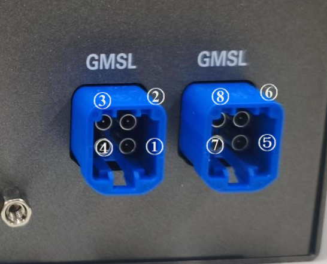

#### Linux kernel version

* Linux 6.18.23

#### Supported Camera Modules

* SHF3L
  * support max 8 cameras to bring up at the same time

* M3A
  * support max 8 cameras to bring up at the same time 

* SG3S_GMSL2F
  * support max 8 cameras to bring up at the same time 

#### Quick Bring Up

#### 1. BIOS Setting

System I/O --> 
  ```
  Camera1: Disabled
  Camera2: Disabled
  Camera3: Disabled
  ```

System I/O --> Digital IO Port Configuration --> 
  ```
  PWM0: Enabled
  ```

#### 2. Connect the Camera to the ports on the adapter board.

   

   GroupA (CAM1/CAM2/CAM3/CAM4)

   GroupB (CAM5/CAM6/CAM7/CAM8)

#### 3. Install Required Dependencies
  Once Ubuntu 24.04 is installed on the Robinson Bay, install the required dependencies, including v4l-utils and acpica.

3.1 Install v4l-utils

  ```
  sudo apt install debhelper doxygen gcc git graphviz libasound2-dev libjpeg-dev libqt5opengl5-dev
  libudev-dev libx11-dev meson pkg-config qtbase5-dev udev libsdl2-dev libbpf-dev llvm clang

  git clone git@github.com:gjasny/v4l-utils.git
  cd v4l-utils/
  meson setup build/
  ninja -C build/
  sudo ninja -C build/ install
  ```

3.2 Install acpica

  ```
  sudo apt install flex bison

  wget https://github.com/acpica/acpica/releases/download/20260408/acpica-unix-20260408.tar.gz
  tar zxf ./acpica-unix-20260408.tar.gz
  cd acpica-unix-20260408
  make
  sudo make install
  ```


#### 4. Install Kernel and Camera Driver

  Copy the driver package to the Robinson bay, run the command below to install kernel and camera driver.

  ```
  cd ROBINSON_BAY_INTEL_PTL_IPU7_CAMERA/
  chmod a+x ./install.sh
  sudo ./install.sh
  ```

  then, reboot the system
  ```
  sudo reboot
  ```

#### 5. Bring up the GMSL Camera

5.1 Construct pipeline
  ```
  cd ROBINSON_BAY_INTEL_PTL_IPU7_CAMERA/
  chmod a+x script/acpi/mc-setup.sh
  chmod a+x script/acpi/gen_ssdt.sh
  ./script/acpi/mc-setup.sh
  ```

  Check the log output to identify the device node associated with each camera.

  ```
WARN: DES1 link 0: serializer at \_SB_.PC00.DES1.CH00.SER0 has no v4l-subdev (driver loaded?); skipping
WARN: DES1 link 1: serializer at \_SB_.PC00.DES1.CH01.SER1 has no v4l-subdev (driver loaded?); skipping
WARN: DES1 link 2: serializer at \_SB_.PC00.DES1.CH02.SER2 has no v4l-subdev (driver loaded?); skipping
WARN: DES1 link 3: serializer at \_SB_.PC00.DES1.CH03.SER3 has no v4l-subdev (driver loaded?); skipping
WARN: DES1 (\_SB_.PC00.DES1): no supported cameras discovered; skipping
Discovered topology:
  DES0  \_SB_.PC00.DES0                    max96724 0-0027 -> Intel IPU7 CSI2 0 (capture base /dev/video0)
    SER0  \_SB_.PC00.DES0.CH00.SER0          max96717 4-0040
    CAM0  \_SB_.PC00.DES0.CH00.SER0.CAM0     isx031 22-001a  (model=isx031, hid=INTC113C)
    SER1  \_SB_.PC00.DES0.CH01.SER1          max96717 15-0040
    CAM1  \_SB_.PC00.DES0.CH01.SER1.CAM1     isx031 23-001a  (model=isx031, hid=INTC113C)
    SER2  \_SB_.PC00.DES0.CH02.SER2          max96717 16-0040
    CAM2  \_SB_.PC00.DES0.CH02.SER2.CAM2     isx031 24-001a  (model=isx031, hid=INTC113C)
    SER3  \_SB_.PC00.DES0.CH03.SER3          max96717 17-0040
    CAM3  \_SB_.PC00.DES0.CH03.SER3.CAM3     isx031 25-001a  (model=isx031, hid=INTC113C)


Configuration summary:
  DES0 LINK0	 Sensor model	 isx031
                 Stream          [single] 1920x1536  UYVY8_1X16    30.000 FPS -->  /dev/video0
  DES0 LINK1	 Sensor model	 isx031
                 Stream          [single] 1920x1536  UYVY8_1X16    30.000 FPS -->  /dev/video1
  DES0 LINK2	 Sensor model	 isx031
                 Stream          [single] 1920x1536  UYVY8_1X16    30.000 FPS -->  /dev/video2
  DES0 LINK3	 Sensor model	 isx031
                 Stream          [single] 1920x1536  UYVY8_1X16    30.000 FPS -->  /dev/video3
  ```

5.2 Print the camera frame rate

  ```
  ## Example: For Video0
  v4l2-ctl -d /dev/video0 --stream-mmap
  ```

5.3 Preview the camera feed

  ```
  ## Example: For Video0
  gst-launch-1.0 -v \
      v4l2src device=/dev/video0 io-mode=mmap \
      ! 'video/x-raw,format=UYVY,width=1920,height=1536,framerate=30/1' \
      ! videoconvert \
      ! autovideosink sync=false
  ```

#### 6. Camera Trigger Sync

  Perform the required hardware modifications according to "928999_Robinson Bay GMSL PWM Hardware Rework Fsync Guide_Rev1p0.pdf", and update the BIOS to version V06J2M13 or later.

6.1  Set the camera fsync Mode

  Update the corresponding asl configuration file located in the acpi/ipu7/robinson_bay directory.

  ```
  #define EXTERNAL_FRAME_SYNC 1
  ```

  Then, rerun the install.sh script and reboot the system.
  ```
  sudo ./install.sh
  sudo reboot
  ```

6.2 Enable PWM Output

  ```
  chmod a+x ./pwm.sh
  sudo ./pwm.sh
  ```

6.3 bring up the camera

  Print the camera frame rate

  ```
  script/acpi/mc-setup.sh
  
  ## Example: For Video0
  v4l2-ctl -d /dev/video0 --stream-mmap
  ```